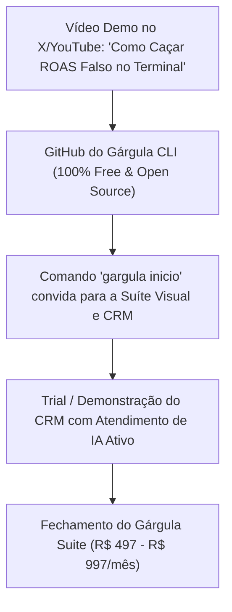

# Estratégia de Monetização: Gárgula RevOS Suite

Este documento define o plano comercial, arquitetura de empacotamento e estratégia de go-to-market (GTM) para monetizar o ecossistema do **Gárgula**, combinando o motor de terminal open source com o **CRM proprietário** e serviços de nuvem de alta margem.

---

## 🏛️ A Tese do Negócio

No mercado de vendas digitais e tráfego pago (infoprodutos, e-commerce, afiliados, negócios locais e agências), os operadores enfrentam 3 dores sangrentas:

1. **Gasto Cego em Tráfego:** O Meta Ads mente ou atrasa conversões (por conta do iOS 14). Operadores queimam de R$ 2.000 a R$ 50.000/mês sem saber quais anúncios de fato geram lucro líquido no checkout e quais geram boletos abandonados.
2. **Lentidão e Perda de Vendas no WhatsApp:** Mais de 60% das vendas de infoprodutos e serviços são fechadas no 1 a 1 do WhatsApp. O tempo médio de resposta de atendentes humanos é de 40 minutos. Cada minuto de demora reduz a conversão drasticamente.
3. **Ferramentas Caras e Fragmentadas:** Para rodar uma operação, a empresa precisa assinar:
   - CRM de WhatsApp (Kommo / ManyChat / Chatwoot): **R$ 250 a R$ 600/mês**
   - Ferramenta de Atribuição (Triple Whale / Hyros): **US$ 150 a US$ 500/mês**
   - Copywriters / Agência de Criativos: **R$ 2.000 a R$ 5.000/mês**

**A Solução Gárgula Suite:**
Um ecossistema unificado onde o **Agente de Terminal (Gárgula CLI)** diagnostica, fatias de criativos e reconcilia o ROAS Real, enquanto o **CRM Proprietário (Next 15 + Postgres + IA)** atende em segundos, filtra leads quentes e passa para o time comercial fechar com um clique.

---

## 📦 A Composição do Pacote (Gárgula RevOS)

```
┌─────────────────────────────────────────────────────────────┐
│                      GÁRGULA REVOS SUITE                    │
├──────────────────────────────┬──────────────────────────────┤
│       GÁRGULA CLI            │         GÁRGULA CRM          │
│   (Inteligência & Tática)    │   (Operação & Atendimento)   │
├──────────────────────────────┼──────────────────────────────┤
│ • Brand & Offer DNA          │ • Multi-atendente WhatsApp   │
│ • Filtro Anti-Slop (Zero IA) │ • Agente Nativo com Trava    │
│ • War Room CRO (Stress Test) │ • Guardrails contra Alucinar │
│ • Reconciliação ROAS Real    │ • Handoff Invisível p/ Time  │
│ • Creative Factory (Ganchos) │ • Links de Pagamento 1-Clique│
│ • Terminal Autônomo Seguro   │ • Rastreio Manda Bem Embutido│
└──────────────────────────────┴──────────────────────────────┘
```

---

## 💰 Tabela de Planos e Preços

### Tier 1: Gárgula Open Source (Gratuito / GitHub)
* **Público:** Desenvolvedores, operadores técnicos, entusiastas de IA local.
* **Modelo:** BYOK (Bring Your Own Key), código aberto MIT.
* **O que inclui:**
  * Motor completo do Gárgula CLI no terminal.
  * Todas as ferramentas locais: arquivos, terminal, busca no Obsidian, leitura web e Graph API do Meta Ads.
  * Comandos de CRO, Reconciliação, Criativos e Sniper de Objeções.
* **Papel no Negócio:** **Topo de Funil Viral e Prova Social Imbatível.** Nenhuma agência ou infoprodutor duvida da capacidade de um software auditável que roda na máquina deles.

---

### Tier 2: Gárgula Pro / Operador Solo
* **Público:** Afiliados, produtores solos, gestores de tráfego freelance.
* **Preço:** **R$ 97 / mês** (ou **R$ 890 / ano** à vista).
* **O que inclui:**
  * **App Desktop Visual (Gárgula Glass / Aura):** Interface gráfica moderna com tema dark/roxo para quem não quer abrir o terminal.
  * **Watchdog de Alertas 24/7:** O Gárgula monitora o Meta Ads e manda avisos de emergência no WhatsApp pessoal do gestor quando um anúncio fadigou ou o ROAS caiu.
  * **Biblioteca de Packs de DNA:** Acesso a 5 templates pré-treinados de nicho (Odonto, Estética, E-commerce, Infoproduto, Serviços).

---

### Tier 3: Gárgula Suite / Agências & Equipes (O Carro-Chefe)
* **Público:** Agências de tráfego, coprodutoras, empresas de direct sales com vendedores.
* **Preço:** **R$ 497 a R$ 997 / mês** (dependendo do volume de números de WhatsApp).
* **O que inclui:**
  * **O CRM Proprietário Completo Instalado:**
    * Painel web em Next 15 para toda a equipe comercial.
    * Conexão multi-número de WhatsApp e Instagram Direct.
    * Agente de IA com **constituição blindada**: responde dúvidas frequentes em 3 segundos e **nunca inventa descontos** (guardrails estritos de catálogo).
    * Handoff silencioso para vendedores humanos quando o lead pede negociação.
    * Disparos de alerta de lead quente no WhatsApp privado do vendedor.
  * **Relatórios White-Label de CRO e Atribuição:** A agência gera relatórios em PDF com sua própria logo para impressionar seus clientes e justificar honorários de R$ 3.000+.
  * **Onboarding & Setup Dedicado:** Instalação guiada na VPS do cliente com Docker e Postgres isolado.

---

## 🚀 Funil de Aquisição de Clientes (Go-To-Market)



### Script de Abordagem para Fechar as Primeiras Agências:
> *"Você roda tráfego para quantos clientes hoje? O Meta Ads costuma marcar compras que na verdade foram boletos nunca pagos na Kiwify/Hotmart. Nós criamos uma auditoria em terminal que cruza o gasto real com o extrato bancário em 10 segundos, além de entregar um CRM com IA que atende em 3 segundos e passa o lead quente para o seu vendedor. Quer que eu rode um teste na sua conta mais cara hoje à tarde?"*

---

## 📈 Projeção Financeira Conservadora (12 Meses)

| Mês | Clientes Pro (R$ 97) | Clientes Suite (R$ 497) | Faturamento Mensal (MRR) |
|---|---|---|---|
| Mês 1 | 15 | 3 | R$ 2.946,00 |
| Mês 3 | 50 | 12 | R$ 10.814,00 |
| Mês 6 | 150 | 35 | R$ 31.945,00 |
| Mês 12 | 400 | 100 | R$ 88.500,00 |

*Com menos de 100 clientes de agência no plano Suite, o ecossistema atinge quase **R$ 1 milhão de ARR (Receita Recorrente Anual)**, operando com infraestrutura leve e código proprietário sem repasse de royalties.*

